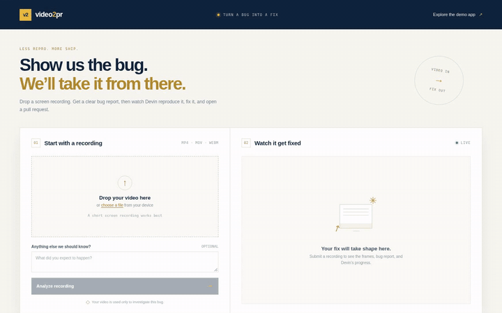

# video2pr

Turn a phone screen recording of a web-app bug into a structured report and a Devin session that reproduces and fixes it.


<sub>Real Devin run, waiting parts sped up. Full video: [`docs/media/real_mode_demo.mp4`](docs/media/real_mode_demo.mp4) (resulting PR: #14, intentionally unmerged). Slides: [`docs/media/video2pr_slides.pptx`](docs/media/video2pr_slides.pptx) / [PDF](docs/media/video2pr_slides.pdf).</sub>

### Backup mode



<sub>Backup (mock) mode, sped up 2x. Full-speed recording: [`docs/media/backup_mode_walkthrough.mp4`](docs/media/backup_mode_walkthrough.mp4). Final screen: [`docs/media/walkthrough_result.png`](docs/media/walkthrough_result.png).</sub>

## Architecture

```text
Phone/browser video
        │
        ▼
FastAPI upload ──► ffprobe + ffmpeg frame extraction
        │
        ▼
Vision report (Devin structured output / OpenAI / Anthropic / local mock)
        │
        ▼
Devin API session (or simulated session)
        │
        ├──► Static frontend: progress, frames, report, messages, PR
        └──► /demo/: GT Dining ordering app for the repro walkthrough
```

## Run locally

```bash
python3 -m venv .venv
source .venv/bin/activate
pip install -r requirements.txt
cp .env.example .env
uvicorn backend.main:app --reload --port 8000
```

The frontend is available at <http://localhost:8000>, and the sample GT Dining app is at <http://localhost:8000/demo/>.

Set `VISION_PROVIDER` to `devin`, `openai`, `anthropic`, or `mock` to choose the vision provider explicitly. When unset, a live Devin key is preferred, followed by OpenAI, Anthropic, then the local mock. Devin vision attaches the ordered video frames and asks Devin to submit a structured bug report before reproducing the issue. Set `VISION_PROVIDER=devin` with `MOCK_DEVIN=1` to rehearse that flow without creating a real session.

Without provider keys, video reports use a mock report and Devin sessions run in simulation mode. Add `OPENAI_API_KEY` or `ANTHROPIC_API_KEY` for external vision analysis. Add `DEVIN_API_KEY` to create real Devin sessions: `cog_` personal access tokens use Devin API v3, while legacy tokens use v1. `DEVIN_ORG_ID` selects the v3 organization, and `MOCK_DEVIN=1` forces session simulation. The simulated session takes about 40 seconds by default; set `MOCK_DEVIN_SECONDS` to change that duration.

Select multiple recordings to start parallel investigations. `POST /api/reports/batch` accepts 1 to `MAX_BATCH_VIDEOS` files (default 4) and an optional note shared across the batch.

`run.sh` starts the same development server.
